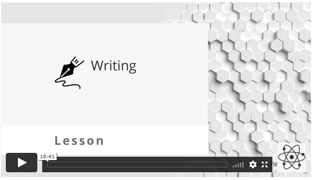
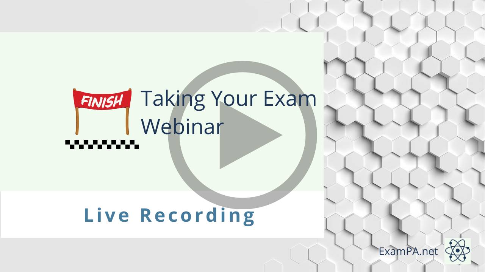

---
output:
  html_document: default
  pdf_document: default
description: "Writing and communication guidance for Exam PA reporting."
keywords: ["writing","communication","Executive Summary","Exam PA","reporting"]
---

# Writing and Communication

Clear, audience-appropriate communication is an important part of analytical work. Exam weighting and task format can change, so use the [current SOA Exam PA materials](https://www.soa.org/education/exam-req/edu-exam-pa-detail/) for exam-specific requirements. This chapter provides general guidance on explaining analytical results. For writing templates and examples, visit [PredictiveInsightsAI.com](https://www.PredictiveInsightsAI.com).

## Spelling and Grammar

## Final Review Webinar

Here we go. The last week. Your months of hard work are about to be put to the test. How are you feeling? Nervous? Confident?

This webinar is for you!

In this water-cooler-style discussion, you can bring all of your awkward or "stupid" questions. Really, though, the only stupid question is the one that never gets asked.

**Review the core concepts**

This recorded discussion reviews selected PA concepts and study strategies. It is supplemental material, not a prediction of what will appear on a future exam; check the current SOA syllabus and candidate materials for exam requirements.

