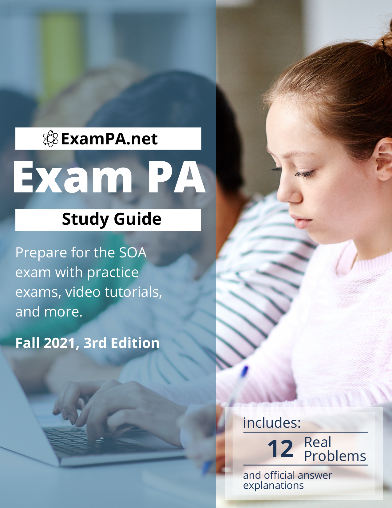
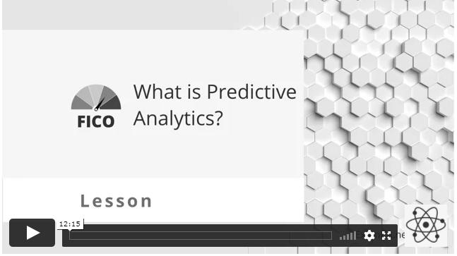

--- 
title: "Exam PA Study Guide, 2026 Edition"
github-repo: https://github.com/sdcastillo
site: bookdown::bookdown_site
output: bookdown::gitbook
documentclass: book
classoption: openany
bibliography: [book.bib, packages.bib]
biblio-style: apalike
link-citations: true
favicon: images/artificial_actuary_logo_favicon.png
description: "Exam PA study guide for predictive analytics with R, modeling, and communication."
keywords: ["Exam PA study guide","predictive analytics","R","modeling","communication"]
---

# Welcome {-}

<hr>

This is the study guide for [https://PredictiveInsightsAI.com](Predictive Insights), the online course for the Predictive Analytics exam of SOA. While meeting all of the learning requirements of Exam PA, this 250-page study guide gives data science and machine learning training. It would be taught how to get data into R, clean it, visualize it, and use models to derive business value. Just as scientists set up lab experiments to form and test hypotheses, it would be required to build models and test them on holdout sets.

For updates, new resources, and companion materials, visit [PredictiveInsightsAI.com](https://PredictiveInsightsAI.com). Follow on X: [\@SamCast65215624](https://x.com/SamCast65215624). Buy the PDF: [Amazon](https://a.co/d/cpy7RSx).

The chapters on R-programming cover the foundational concepts with a focus on modern data science applications. Time-saving coding tips along with ways of checking answers within RStudio will be taught.

All of the statistical theory is explained, from linear regression to gradient boosted trees, and examples are provided of each model that can be reproduced. Following the course materials “An Introduction to Statistical Learning, “we discuss model training, validation, and the advantages and disadvantages of each algorithm.


<iframe width="560" height="315" src="https://www.youtube-nocookie.com/embed/F2okL4a2YcM?rel=0&modestbranding=1&playsinline=1" title="YouTube video player" frameborder="0" allow="accelerometer; autoplay; clipboard-write; encrypted-media; gyroscope; picture-in-picture" allowfullscreen></iframe>

</br>

```{block, type='rcorners'}
<font size="10">**[Get Started](https://PredictiveInsightsAI.com/#enrollment)**</font>
```

</br>


## FAQ: Frequently Asked Questions

**Does this replace the SOA modules?** No. Use this guide as a supplement, and check the SOA's current syllabus and study materials for the authoritative exam requirements.

**Why is this free when other study manuals cost hundreds of dollars?** We are making this available to everyone to study for PA and try out our study materials. We are so confident of the benefits from our hands-on teaching style that everyone will want to join our online course after getting a taste of this textbook.  

**How many study hours are needed?** [This study template](https://PredictiveInsightsAI.com/study-schedule/) offers one 160-hour plan for the course and SOA modules; it is a planning aid, not an SOA requirement. The time needed varies by individual based on prior R experience, exam preparation, communication skills, and other commitments.

# The exam

**Historical-content notice:** Earlier editions of this manual described exam durations, software, task weights, pass rates, and Prometric procedures that may no longer be current. They are not current exam guidance and have been removed here. Check the [SOA Exam PA page](https://www.soa.org/education/exam-req/edu-exam-pa-detail/) and its linked syllabus and candidate materials for current requirements.

The manual's examples focus on analytical reasoning and communicating model results in a business context. Follow the current SOA instructions for the format, tools, permitted resources, and submission requirements for your sitting.

</br>

# Introduction

[](https://PredictiveInsightsAI.com/)


While “machine learning” is relatively new, the process of learning itself is not. All of us are already familiar with how to learn - by improving from our mistakes. By repeating what is successful and avoiding what fails, we learn by doing, by experience, or trial-and-error. Machines learn similarly.

Take, for example, the process of studying for an exam. Some study methods work well, but other methods do not. The “data” is the practice problem, and the “label” is the answer (A, B, C, D, E). We want to build a mental “model” that reads the question and predicts the answer.

We all know that memorizing answers without understanding concepts is ineffective, and statistics calls this “overfitting.” Conversely, not learning enough of the details and only learning the high-level concepts is “underfitting.”

The more practice problems we do, the larger the training data set, and the better the prediction. When we see new problems that have not appeared in the practice exams, we often have difficulty. Quizzing ourselves on real questions estimates our preparedness, which is identical to a process known as “holdout testing” or “cross-validation.”

We can clearly state our objective: get as many correct answers as possible! We want to predict the solution to every problem correctly. Said another way, we are trying to minimize the error, known as the “loss function.”

Different study methods work well for different people. Some cover material quickly, and others slowly absorb every detail. A model has many “parameters,” such as the “learning rate.” The only way to know which parameters are best is to test them on real data, known as “training.”
